<p align="center">
  
</p>

<p align="center"><strong>Nenhuma intimação passa despercebida.</strong></p>

<p align="center">
  <a href="https://oliveiracarlosadv.github.io/nao-esquece-adv/"><strong>▶ Abrir o webapp</strong></a>
  &nbsp;·&nbsp;
  <a href="https://oliveiracarlosadv.github.io/nao-esquece-adv/sobre/">Sobre</a>
  &nbsp;·&nbsp;
  <a href="docs/MANUAL-DO-USUARIO.md">Manual</a>
  &nbsp;·&nbsp;
  <a href="docs/TERMOS-DE-USO.md">Termos de uso</a>
  &nbsp;·&nbsp;
  <a href="CHANGELOG.md">Novidades</a>
</p>

---

## Objetivo

O **NÃO ESQUECE ADV** é um webapp para advogados, escritórios de advocacia e departamentos jurídicos que **monitora automaticamente, a cada 1 hora**, intimações, citações, notificações, andamentos processuais, menções ao advogado (nome, CPF e OAB) e publicações em licitações públicas, e reúne tudo em **um único painel** com controle de leitura, prazos calculados, pesquisa avançada e exportação.

O app é **100% gratuito e completo (versão full)**: todos os recursos liberados, sem planos nem limites.

Diferencial: **os dados ficam no seu computador**, guardados no próprio navegador. Não há servidor central com informações de clientes, o que simplifica muito a adequação à LGPD. Backups podem ser criados, exportados e importados a qualquer momento, inclusive com senha.

**Link direto:** https://oliveiracarlosadv.github.io/nao-esquece-adv/
Para conhecer sem cadastrar nada, clique em **“Ver demonstração”** (dados fictícios).

---

## Imagens do app

<p align="center">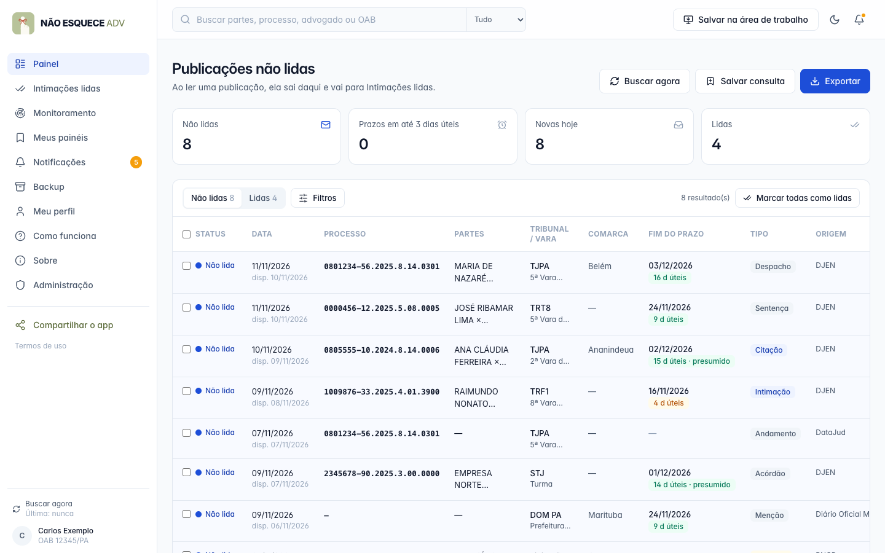</p>

| | |
|---|---|
| 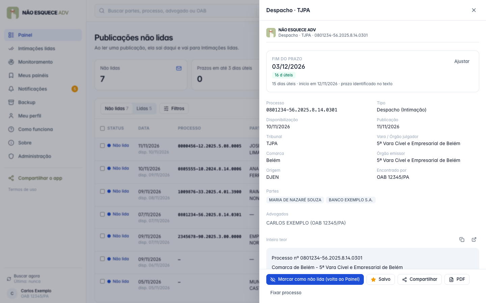 | 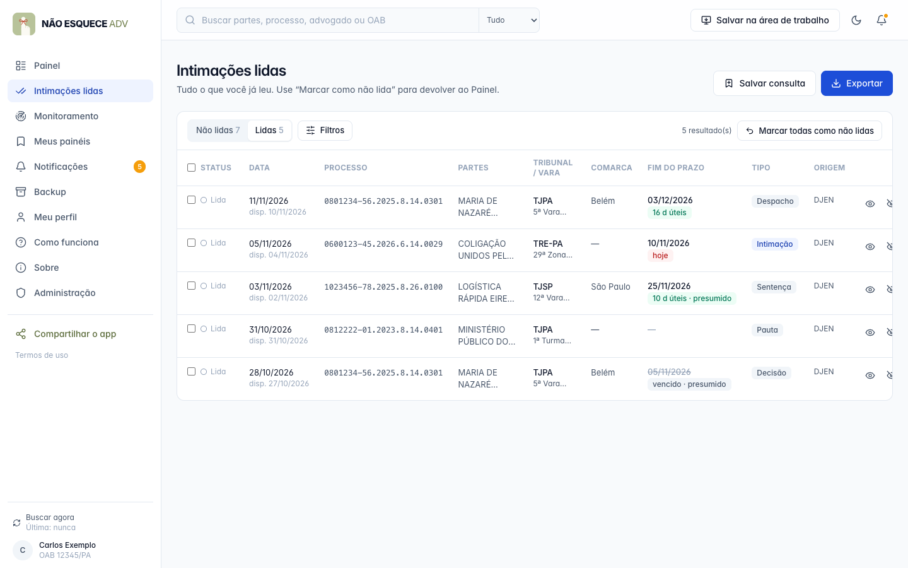 |
| **Publicação aberta:** prazo, dados extraídos e inteiro teor | **Intimações lidas:** o que já foi lido sai do Painel |
| 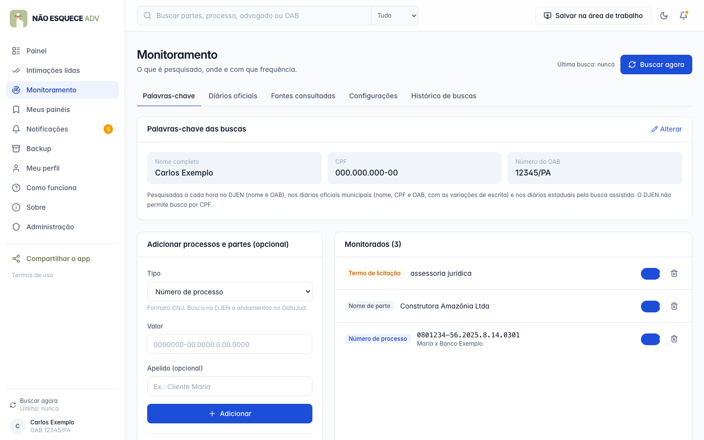 | 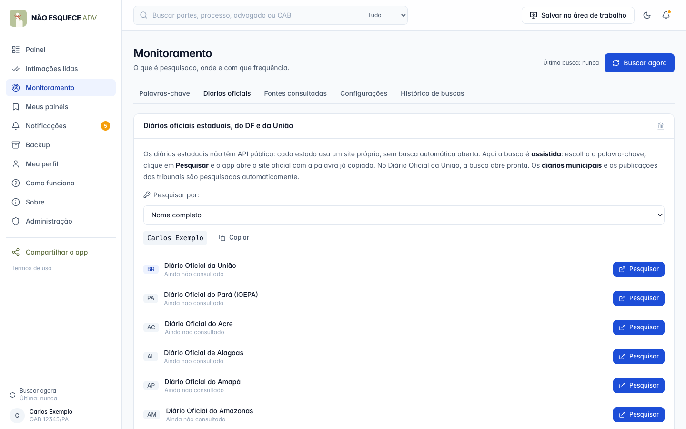 |
| **Palavras-chave:** nome completo, CPF e OAB | **Diários oficiais:** estaduais, DF e União |
| 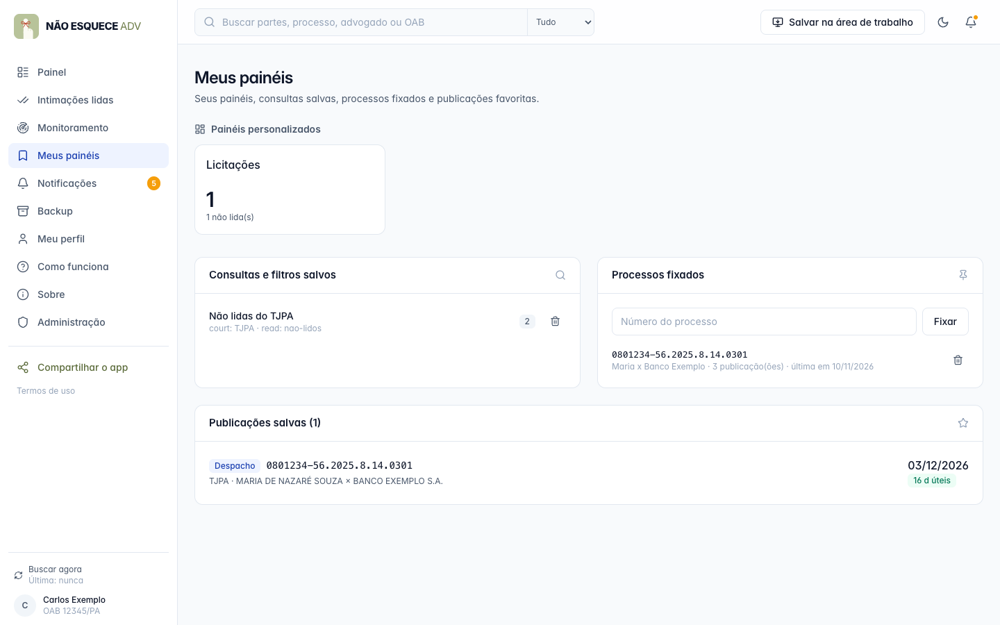 | 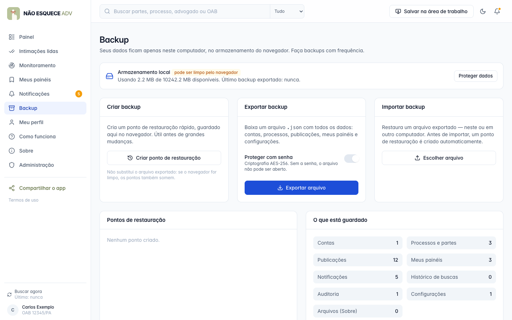 |
| **Meus painéis:** consultas, painéis e processos fixados | **Backup:** criar, exportar e importar |
| 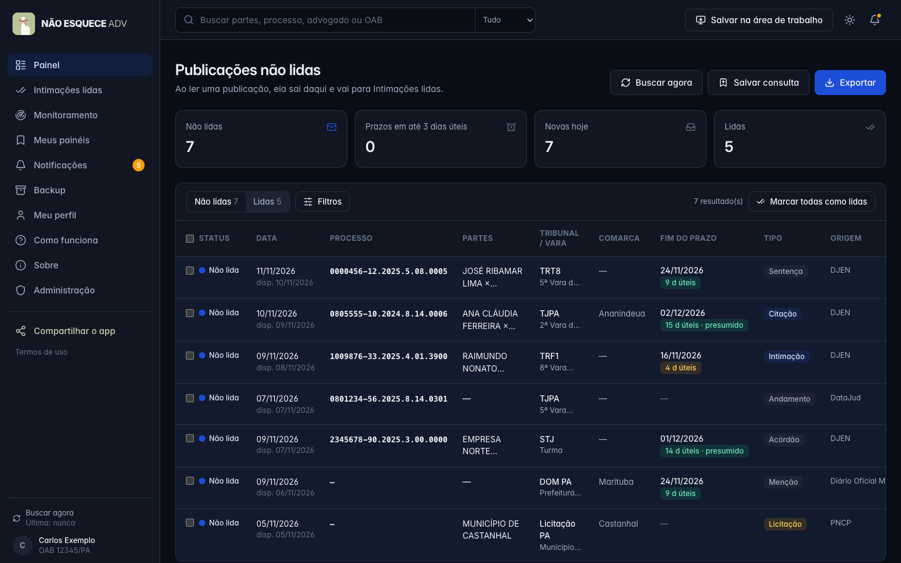 | 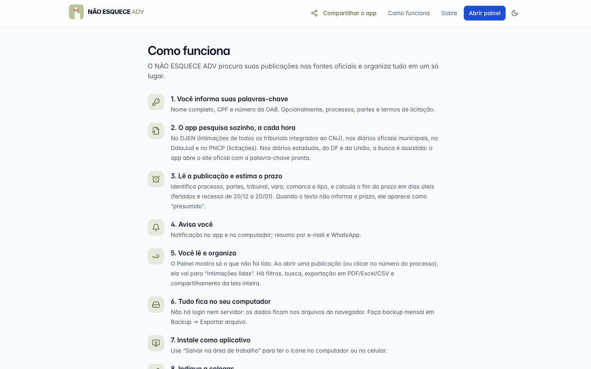 |
| **Tema escuro** | **Como funciona** e aviso de responsabilidade |
| 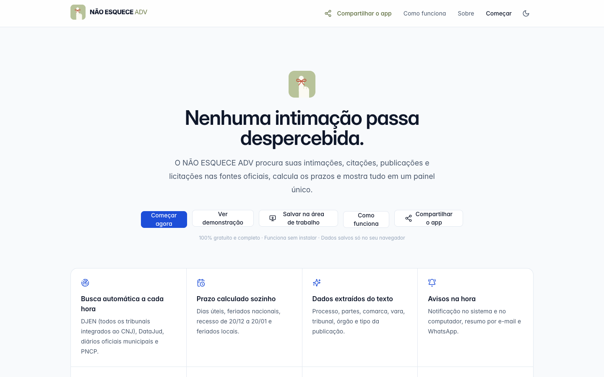 | 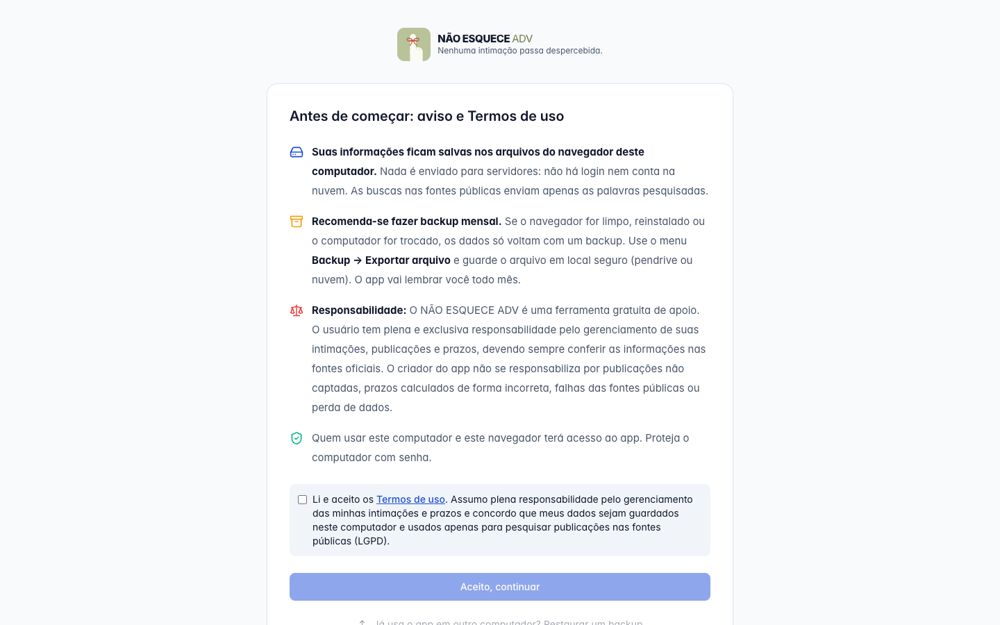 |
| **Página inicial** | **Primeira abertura:** aviso, backup mensal e Termos de uso |

<p align="center">
  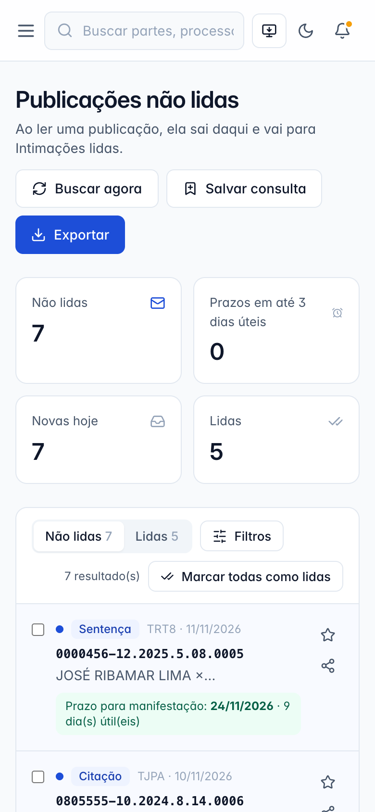
  &nbsp;&nbsp;
  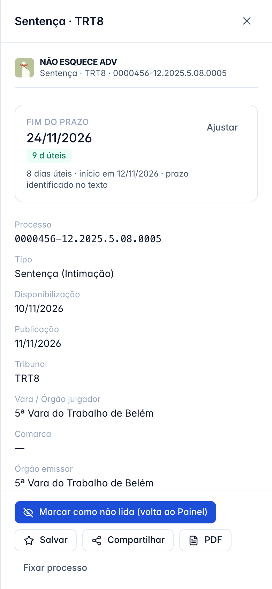
  <br><em>No celular: prazo para manifestação sempre visível e publicação aberta</em>
</p>

> Imagens geradas com a conta de demonstração (dados fictícios).

---

## Como funciona

```
 Você cadastra           O app pesquisa              O app lê e organiza        Você recebe
 ─────────────           ──────────────              ───────────────────        ───────────
 Nome, CPF, OAB    ──▶   DJEN (CNJ)            ──▶   Nº do processo       ──▶   Painel único
 Processos               DataJud (CNJ)               Partes, vara, comarca      Notificações
 Partes                  Diários municipais          Tribunal, órgão            Exportação
 Termos de licitação     PNCP (licitações)           Tipo da publicação         Backup
                         a cada 1 hora               Fim do prazo
```

1. **Primeira abertura (sem login)** — o app avisa que as informações ficam salvas nos arquivos do navegador deste computador e recomenda **backup mensal**. Depois você informa nome completo, CPF e OAB/UF (as **palavras-chave** das buscas), além de telefone, e-mail, foto e logomarca opcionais. **Gratuito e completo: sem planos, sem cobrança, sem limites.**
2. **Monitoramento** — as palavras-chave são o **nome completo, o CPF e o número da OAB**. Processos, partes, CNPJ e termos de licitação podem ser adicionados (opcional).
3. **Busca automática** — a cada hora (configurável), enquanto o app estiver aberto em alguma aba ou instalado como aplicativo. Na primeira vez, busca os últimos 30 dias.
4. **Processamento inteligente** — cada publicação é lida para extrair número do processo, partes, tribunal, vara, comarca, órgão emissor e categoria (intimação, citação, sentença, despacho, acórdão, pauta, edital, licitação…).
5. **Prazo automático** — quando o texto informa o prazo (“no prazo de 15 (quinze) dias”), o fim é calculado em **dias úteis**, com publicação no 1º dia útil após a disponibilização (Lei 11.419/2006, art. 4º), feriados nacionais e móveis, **suspensão de 20/12 a 20/01** (CPC, art. 220) e feriados locais. Quando não há prazo no texto, aplica-se um prazo **presumido** (CPC, art. 218, §3º), sinalizado para conferência.
6. **Painel** — mostra só o que ainda **não foi lido**. Ao abrir (ler) uma intimação, ela sai do Painel e vai para **Intimações lidas**; “Marcar como não lida” devolve. Tabela com Lida/Não lida, datas de publicação e disponibilização, processo, partes, tribunal/vara, comarca, fim do prazo, tipo, origem e ações (visualizar, marcar como lido/não lido, salvar, exportar, compartilhar).
7. **Avisos** — notificações no sistema e do computador; resumo por e-mail e WhatsApp.

### Fontes consultadas

| Fonte | O que traz | Situação |
|---|---|---|
| **DJEN — Diário de Justiça Eletrônico Nacional (CNJ)** | Intimações e comunicações de TJs, TRFs, TRTs/TST, TREs/TSE, Justiça Militar e tribunais superiores integrados | ✅ Funciona direto no navegador |
| **PNCP — Portal Nacional de Contratações Públicas** | Editais e avisos de licitação (União, estados, municípios) | ✅ Funciona direto no navegador |
| **DataJud — API pública do CNJ** | Andamentos dos processos cadastrados | ⚙️ Requer o conector local |
| **Diários Oficiais Municipais** (Querido Diário) | Menções ao nome, CPF e OAB em diários de municípios | ⚙️ Automático, via conector local |
| **Diários Oficiais Estaduais, do DF e da União** | Publicações dos 26 estados, DF e DOU | 🔎 Busca assistida (sem API pública): o app abre o site oficial com a palavra-chave pronta |

> **Conector local:** algumas fontes bloqueiam chamadas vindas do navegador. O arquivo [`conector-local/server.mjs`](conector-local/) é um programa minúsculo, sem dependências, que roda só no seu PC e repassa as consultas a uma lista fechada de sites oficiais. Veja [docs/FONTES-E-PRAZOS.md](docs/FONTES-E-PRAZOS.md).

---

## Funcionalidades

- **Sem login**: perfil único guardado no navegador; aviso de armazenamento local na primeira abertura e **lembrete de backup mensal**.
- **Salvar na área de trabalho**: instala o app como atalho (web app) no computador (Windows, Mac, Linux) e no celular (Android, iPhone/iPad).
- **Painel** com contadores (não lidas, prazos em até 3 dias úteis, novas hoje), filtros e seleção em lote.
- **Filtros**: processo, parte, tribunal, vara, comarca, período, lidas/não lidas, tipo, origem e favoritas.
- **Busca global** com lupa: partes, processo, advogado ou OAB.
- **Exportação** para **PDF, Excel e CSV**, por resultado atual, selecionados ou filtros próprios (vara, processo, tribunal, período, lidos/não lidos).
- **Meus painéis**: consultas e filtros salvos, painéis personalizados com contadores, processos fixados e publicações favoritas.
- **Intimações lidas**: lista própria para o que já foi lido, com filtros, exportação e “Marcar como não lida”. Botão **“Marcar todas como lidas”** no Painel.
- **Compartilhar** uma publicação envia o **teor completo em texto** (dados, prazo e inteiro teor) pelo WhatsApp, e-mail ou outros apps.
- **Compartilhar o app** (menu): indica o NÃO ESQUECE ADV a outros advogados.
- **Como funciona** e **Termos de uso**: o usuário tem plena responsabilidade pelo gerenciamento de suas intimações; aceite obrigatório na primeira abertura.
- **Central de notificações**: histórico de avisos de tudo o que chegou de novo. Avisa no app, no computador (push), por e-mail e WhatsApp (envio automático é integração futura).
- **Backup**: pontos de restauração, exportação `.json` (com criptografia AES-256 opcional) e importação (mesclar ou substituir).
- **Painel administrativo**: logomarcas, bases e APIs, logs de pesquisas, auditoria, relatórios e a pasta da página Sobre.
- **Página Sobre** montada automaticamente a partir dos arquivos de uma pasta (`conteudo/sobre/` ou outra escolhida pelo administrador).
- **Tema claro e escuro**, layout responsivo (desktop, tablet e celular) e **instalável como aplicativo** (PWA), com ícone para o Dock do Mac, barra de tarefas do Windows e tela inicial do celular.

---

## Tecnologia

| Camada | Escolha |
|---|---|
| Interface | Next.js 15 (exportação estática), React 19, TypeScript, TailwindCSS |
| Dados | IndexedDB (via Dexie) — **no navegador do usuário** |
| Segurança | Web Crypto (AES-256-GCM nos backups com senha) |
| Exportação | jsPDF + AutoTable, ExcelJS, CSV nativo |
| Offline | Service Worker + Web App Manifest |
| Conector local | Node.js puro (sem dependências) |
| Publicação | GitHub Pages via GitHub Actions |

> O pedido original previa NestJS, PostgreSQL, Redis e S3. Por decisão posterior, **todas as informações passaram a ficar offline no PC**, o que dispensa servidor e banco central. A estrutura do código permite plugar um backend no futuro, se for preciso sincronizar vários computadores. Detalhes em [docs/ARQUITETURA.md](docs/ARQUITETURA.md).

---

## Rodar no seu computador

Requisitos: **Node.js 20+**.

```bash
git clone https://github.com/oliveiracarlosadv/nao-esquece-adv.git
cd nao-esquece-adv
npm install
npm run dev:web          # abre em http://localhost:3000
```

Conector local (opcional, em outro terminal):

```bash
npm run conector         # http://127.0.0.1:8787
```

Depois, em **Monitoramento → Configurações**, informe `http://127.0.0.1:8787`.

Gerar a versão estática (pasta `apps/web/out`):

```bash
npm run build
```

Testes do cálculo de prazos e da extração:

```bash
npm test -w apps/web
```

---

## Estrutura

```
apps/web/            Webapp (Next.js)
  src/app/           Telas: painel, lidas, monitoramento, meus painéis, notificações,
                     backup, perfil, administração, sobre, primeiros passos (cadastro)
  src/lib/           Núcleo: banco local, prazos, extração, fontes, monitor,
                     backup, exportação, notificações, criptografia
  src/components/    Componentes visuais
conector-local/      Ponte opcional para fontes que bloqueiam o navegador
conteudo/sobre/      Textos e imagens da página Sobre
brand/               Logomarca: mão com fita no dedo + ramo de oliveira (SVG/PNG)
docs/                Documentação
PEDIDOS/             Histórico de todos os pedidos (Markdown)
scripts/backup.sh    Gera um .zip datado do código em BACKUPS/
```

## Documentação

- [Manual do usuário](docs/MANUAL-DO-USUARIO.md)
- [Arquitetura](docs/ARQUITETURA.md)
- [Fontes e cálculo de prazos](docs/FONTES-E-PRAZOS.md)
- [Segurança e LGPD](docs/SEGURANCA-LGPD.md)
- [Backup e restauração](docs/BACKUP.md)
- [Publicação (GitHub Pages)](docs/PUBLICACAO.md)
- [Termos de uso](docs/TERMOS-DE-USO.md)
- [Histórico de pedidos](PEDIDOS/README.md)

## Aviso

O NÃO ESQUECE ADV é uma ferramenta gratuita de apoio. **O usuário tem plena e exclusiva responsabilidade pelo gerenciamento de suas intimações, publicações e prazos**, devendo conferir tudo nas fontes oficiais; o criador não se responsabiliza por publicações não captadas, prazos calculados ou falhas das fontes. Veja os [Termos de uso](docs/TERMOS-DE-USO.md).

## Autor

**Carlos Alexandre Albuquerque Oliveira** — advogado, Belém/PA
[@oliveiracarlosadv](https://instagram.com/oliveiracarlosadv) · carlos.0109adv@gmail.com

© 2026 LexTecnologias. Todos os direitos reservados.
