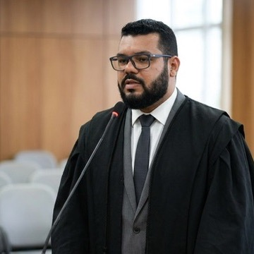

## Quem criou

**Carlos Alexandre Albuquerque Oliveira** é advogado, empreendedor jurídico e pesquisador permanente do Direito, reconhecendo na aprendizagem contínua um dos pilares de sua atuação profissional. Natural de Belém do Pará, desenvolve seu trabalho junto a pessoas físicas e jurídicas, aliando sólida experiência na advocacia contenciosa à constante busca por inovação e eficiência na prestação de serviços jurídicos.

Ao longo de sua trajetória, consolidou-se como profissional comprometido com a excelência técnica e com a transformação digital do setor jurídico. Entre 2020 e 2026, foi sócio-fundador do escritório Sampaio & Oliveira Advogados, onde exerceu a função de Diretor do Setor de Demandas Contenciosas, liderando estratégias processuais, equipes e soluções voltadas à defesa dos interesses de clientes em diferentes áreas do Direito.

Apaixonado por música, tecnologia e conhecimento, Carlos dedica parte significativa de sua atuação ao desenvolvimento de soluções tecnológicas para advogados, acreditando que a inovação é um instrumento essencial para tornar a advocacia mais eficiente, acessível e conectada às necessidades da sociedade contemporânea.

Na internet, compartilha conhecimento, reflexões e experiências práticas sobre advocacia, tecnologia jurídica e transformação digital, ao mesmo tempo em que mantém uma postura aberta ao aprendizado colaborativo com profissionais do Direito, desenvolvedores e entusiastas da tecnologia aplicada ao setor jurídico.

Sua visão combina tradição jurídica e inovação, buscando criar pontes entre o conhecimento técnico, a inteligência digital e os desafios enfrentados pelos profissionais do Direito. Essa atuação multidisciplinar o posiciona como um agente ativo na construção de uma advocacia mais moderna, estratégica e preparada para o futuro.

Carlos Alexandre Albuquerque Oliveira acredita que o Direito evolui quando conhecimento, tecnologia e pessoas caminham juntos, transformando desafios em oportunidades e promovendo soluções capazes de gerar impacto real para profissionais, empresas e cidadãos.

## Contato

- Instagram: [@oliveiracarlosadv](https://instagram.com/oliveiracarlosadv)
- E-mail: [carlos.0109adv@gmail.com](mailto:carlos.0109adv@gmail.com)
- Telefone: (91) 9 8606-1300

